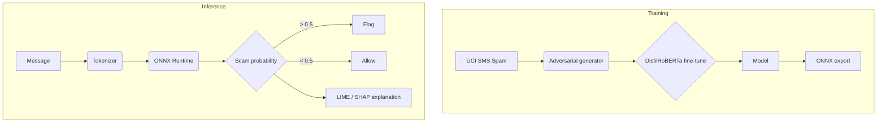

# ScamDefy: Adversarial Robustness Testing for an SMS Scam Classifier

A fine-tuned DistilRoBERTa classifier for scam and spam text messages, with
an adversarial test battery (homoglyphs, leetspeak, combined obfuscation),
ONNX export for fast CPU inference, and a calibrated evaluation at a
realistic 1% scam prevalence.

The aim was to measure how far simple character-level obfuscation can push a
transformer text classifier, and to report the results honestly, including
where it fails.


---

## Data

- **Training and test data:** the
  [UCI SMS Spam Collection](https://archive.ics.uci.edu/dataset/228/sms+spam+collection)
  (5,574 English SMS messages, about 13% spam), deduplicated, with 15% held
  out for testing and 15% of the rest for validation (stratified).
- `src/data_engineering/download.py` also has hooks for Enron and phishing
  email datasets, but in v1.0 these are **3-row placeholders**, so the model
  is effectively trained on SMS spam only.
- Spam in this dataset is mostly marketing and prize scams. It is a proxy for
  authorised push payment (APP) fraud messages, not a sample of them.

## Results (v1.0)

### Standard test set (775 messages, 97 scams)

| Metric | Value |
| :--- | ---: |
| Accuracy | 0.987 |
| Precision | 0.989 |
| Recall | 0.907 |
| F1 | 0.946 |

### Simulated 1% scam prevalence (684 messages, 6 scams)

| Metric | Value |
| :--- | ---: |
| Recall | 1.000 (6 of 6) |
| Precision | 0.857 |
| False positive rate | 0.15% (1 of 678 legitimate messages) |

With only 6 scams in this set, these figures have very wide uncertainty and
should be read as a sanity check, not a performance claim.

### Adversarial ladder (single-example probes)

Each level applies a stronger obfuscation to the same base message and
records the model's scam probability (threshold 0.5). These are individual
probes from `validation_metrics.json`, not detection rates over a test set.

| Level | Attack | Scam probability | Outcome |
| :--- | :--- | ---: | :--- |
| L0 | Clean text | 0.0005 | Missed |
| L1 | Homoglyphs (Cyrillic look-alikes) | 0.0003 | Missed |
| L2 | Leetspeak | 0.9985 | Caught |
| L3 | Homoglyphs + leetspeak | 0.9943 | Caught |
| L5 | Extreme mixed obfuscation | 0.5358 | Caught, only just |

**What this shows:** the model misses the clean account-compromise message
entirely, most likely because that style of message is rare in SMS spam, and
it flags obfuscated text largely because the obfuscation itself looks like
spam. That is a real limitation, and the most useful finding of the project.

### Other probes

- Bank-impersonation phishing text with a fake login link: 0.9989 (PyTorch),
  0.9974 (ONNX)
- Legitimate but urgent personal message ("transfer the rent money today"):
  0.0003, correctly allowed

### Speed

- ONNX Runtime, CPU, batch size 1, one thread: **25.5 ms** per message,
  so about **39 messages per second per thread**.
- Using `src/deployment/cost_model.py` (AWS t3.xlarge on-demand, 70%
  utilisation, one inference thread) that gives roughly **$1.69 per million
  messages**. Running one worker per vCPU would cut this, but that has not
  been benchmarked.

## Known limitations

1. Trained and tested on SMS spam, not real bank fraud transcripts.
2. Misses plain-text account-compromise scams (L0 and L1 above).
3. The 1% prevalence test has only 6 positive examples.
4. A v1.1 retraining run with adversarial examples collapsed and was not
   released.
5. English only; voice and email channels not evaluated.

## Possible extensions

- Add real phishing and APP-scam corpora in place of the placeholders.
- Measure detection rates over a full adversarial test set rather than single
  probes.
- Curriculum training (easy to hard obfuscation) to close the L5 gap.
- Batch and multi-worker throughput benchmarks.

---

## Architecture



## Running it

The trained weights and the ONNX file are **not** in this repository (they
exceed GitHub's file limits), so `demo.py` needs them to be rebuilt first:

```bash
pip install -r requirements.txt

python -m src.data_engineering.download     # fetch UCI SMS Spam
python -m src.data_engineering.pipeline     # clean and split
python -m src.models.transformer            # fine-tune DistilRoBERTa (settings in config/default.yaml)
python -m src.deployment.export_onnx        # export the trained model to ONNX
# copy the exported model.onnx (written next to the trained model in the
# output_dir set in config/default.yaml) into models/release_v1.0/, then:
python demo.py
```

## Repository structure

- `models/release_v1.0/`: frozen configuration, tokenizer, validation
  metrics and report for v1.0 (model binaries excluded)
- `src/`: data engineering, adversarial generator, training, evaluation,
  explainability, deployment and monitoring code
- `demo.py`: single-message ONNX inference demo

## Author

Famul Kalam, MSc Business Analytics, University of Edinburgh.
