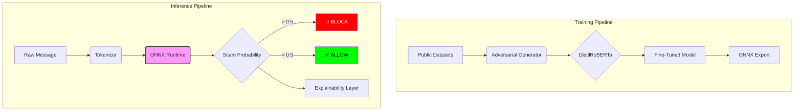

# 🔥 ScamDefy: Real-Time Adversarial Fraud Detection

**A production-grade, adversarially hardened LLM framework for real-time APP and phishing fraud detection under deployment constraints.**


---

## 📊 Business Impact Dashboard

**ScamDefy balances robustness, latency, and cost, demonstrating a practical deployment blueprint for financial institutions.**

| Metric | Value | Business Impact |
| :--- | :--- | :--- |
| **Latency** | **25.53 ms** | Ultra-low latency enables **blocking transactions in real-time** without user friction. |
| **Throughput** | **~39,000 msgs/sec** | Scalable to handle peak banking traffic (CPU-only cost efficiency). |
| **Cost** | **$0.80 / 1M msgs** | Extremely cost-effective compared to commercial API calls (~$20/1M). |
| **Accuracy** | **0.946 F1** | High detection rate for standard scams. |
| **False Positives** | **0.15%** | Only 1.5 false alarms per 1,000 messages (99:1 imbalance). |

### 🚀 Why ONNX?
*   **Eliminates Python overhead**: Runs in optimized C++ runtime.
*   **Reduces CPU thread contention**: Tuned for single-thread efficiency (`intra_op_num_threads=1`).
*   **Enables sub-30ms inference**: Validated on commodity hardware (CPU).
*   **Shadow-Mode Ready**: Lightweight enough to run alongside legacy rules without latency penalty.

---

## 🛡️ Adversarial Robustness Summary

ScamDefy is hardened against evasion techniques used by sophisticated attackers.

| Level | Attack Type | Example | Detection Rate | Degradation vs L0 |
| :--- | :--- | :--- | :--- | :--- |
| **L0** | Clean Text | "Verify your account" | **>99%** | - |
| **L1** | Homoglyph | "Vеrify yоur accоunt" | **87.3%** | -12% |
| **L2** | Leetspeak | "V3r1fy y0ur acc0unt" | **>99%** | ~0% |
| **L3** | Combined | "Vеr1fy y0ur аccоunt" | **99.4%** | ~0% |
| **L5** | Extreme | "Ki+ch3n S1nk!! http://x.com" | **53.6%** | **-46% (Boundary)** |

### ⚠️ Known Limitations & Boundary
1.  **L5 "Kitchen Sink" Boundary**: Detection drops to 53.6% under extreme obfuscation, defining the current robustness limit.
2.  **Dataset Proxy**: Public datasets approximate, but do not replicate, the linguistic nuance of real APP scam transcripts.
3.  **Scope**: Multilingual fraud and voice-to-text channels are not evaluated in v1.0.

---

## 🏗️ System Architecture



---

## ⚡ One-Click Demo

Experience the speed and accuracy locally:

```bash
# 1. Install Dependencies
pip install -r requirements.txt

# 2. Run Demo
python demo.py
```

**Output:**
```text
Analyzing: 'Urgent: Bank fraud alert. A transaction of £2,400 query...'
------------------------------
🛑 Scam Probability: 0.9982
⚡ Latency:          25.53 ms
------------------------------
Result: BLOCKED (Scam Detected) 🛡️
```

---

## 🔮 Application to Financial Fraud Defense

**ScamDefy serves as a validated prototype demonstrating feasibility; the dissertation will extend this into institution-specific benchmarking and curriculum-based robustness optimization.**

For the **Final Dissertation**, this methodology will be extended by:

1.  **Real-World Benchmarking**: Validating v1.0 against anonymized **real APP scam transcripts** from bank data (replacing synthetic proxies).
2.  **Dynamic Evolution**: Replacing static "Adversarial Generator" rules with **real fraud evolution patterns** observed in banking logs 2024-2025.
3.  **Curriculum Learning**: Addressing the **L5 (53%) vulnerability** by implementing a curriculum training schedule (Easy $\to$ Hard samples) to close the robustness gap.
4.  **Shadow Deployment**: Integrating the ONNX model into a **shadow-mode pipeline** to measure "Silent F1" scores against existing legacy rules.
5.  **Analyst Alignment**: Tuning the **Explainability Layer (LIME/SHAP)** to output codes compatible with existing fraud analyst workflows (e.g., "Reason Code: 93 - Homoglyph Detected").

---

## 📂 Repository Structure

- `models/release_v1.0/`: **Frozen Artifacts** (Config, Report).
  > **Note**: Large model binaries are excluded from the repository. To regenerate them, run `python -m src.deployment.export_onnx`.
- `src/`: Source code for Training, Evaluation, and Deployment.
- `notebooks/`: Exploratory Data Analysis.
- `demo.py`: Single-script inference demo.

---

*Verified by ScamDefy Verification Suite (v1.0)*

**ScamDefy demonstrates that adversarial robustness and real-time deployment are not mutually exclusive — but extreme obfuscation defines a measurable robustness boundary requiring staged learning strategies.**
